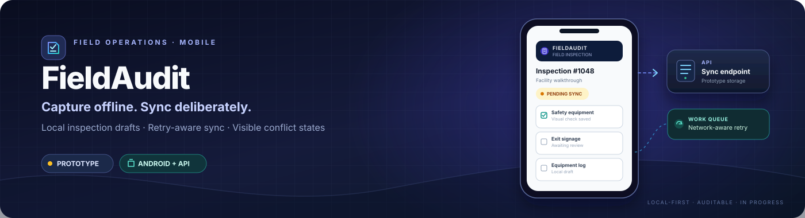

  

<h1 align="center">FieldAudit</h1>

  <strong>Capture offline. Sync deliberately. Keep inspection work visible.</strong> 
  A native Android inspection prototype exploring local-first drafts, network-aware background sync, and explicit failure states.

  
  
  
  
  
  

  <a href="#why-fieldaudit">Why FieldAudit</a> ·
  <a href="#what-works-today">What works</a> ·
  <a href="#architecture">Architecture</a> ·
  <a href="#quick-start">Quick start</a> ·
  <a href="#ci-and-verification">CI & verification</a> ·
  <a href="#security-and-known-limitations">Security & limitations</a> ·
  <a href="#roadmap">Roadmap</a>

---

> [!IMPORTANT]
> **Prototype / active hardening — not ready for real inspection data.** The Android client can save local drafts and now attempts to sync pending records through WorkManager. The FastAPI endpoint has focused syntax and retry-behavior tests. However, the backend still stores records in process memory, authentication is absent, the Room database can fall back to destructive migration, and conflict resolution is incomplete. Read [Security and known limitations](#security-and-known-limitations) before using or extending the project.

## Why FieldAudit

Field work does not always happen where connectivity is reliable. An inspection app should let someone capture work locally, keep it after leaving the screen, and explain what happens when synchronization cannot complete.

FieldAudit is a portfolio project built around that problem. Its current implementation is intentionally small: a Kotlin/Jetpack Compose Android app, Room-based local storage, a WorkManager sync attempt, and a FastAPI service that demonstrates revision-aware responses.

The goal is not to hide failure behind a spinner. A trustworthy inspection workflow must preserve local work, make retries safe, and give the user a clear path when data conflicts. Several of those principles are represented in the current prototype; the remaining engineering gaps are listed explicitly below.

## What works today

| Area | Implemented in the current source | Boundary to understand |
|---|---|---|
| Android UI | A basic Compose screen creates and lists inspection drafts | This is not yet a full checklist, assignment, review, or submission workflow |
| Local storage | Room database, inspection entity, DAO, repository, and observable draft list | Destructive fallback migration remains enabled; upgrade safety is not proven |
| Pending sync | New drafts are stored as **PENDING_SYNC**; WorkManager is enqueued with a connected-network constraint | A record status is used as the queue; there is no separate operation ledger or full process-recovery test suite |
| HTTP sync attempt | Ktor posts pending drafts to the FastAPI endpoint and classifies success, conflict, permanent 4xx, and retryable responses | There is no authentication; the backend is not durable; full server-snapshot conflict resolution is not implemented |
| Retry behavior | Network/server failures preserve pending status and ask WorkManager to retry with exponential backoff | No Retry-After handling, jitter policy, or end-to-end retry verification is present |
| Backend contract | Pydantic request/response models, root status route, sync route, and a scaffold attachment route | Inspection records live in a process-local dictionary and disappear on restart |
| Attachments | An endpoint makes the future upload contract visible | It deliberately returns **NOT_PERSISTED**; uploaded evidence is not stored |
| Automated checks | Separate GitHub Actions workflows for Android and backend | CI does not use PostgreSQL, an Android emulator, full network integration, or dedicated security/dependency scans |

The repository's phase checklist in [docs/PROJECT_STATE.md](docs/PROJECT_STATE.md) is historical planning, not evidence that every listed capability is finished. The working behavior and tests define the current scope.

## Architecture

The flow below describes the **current prototype**, including the storage boundary that still needs replacement.

~~~mermaid
flowchart LR
    A[Compose inspection screen] --> B[ViewModel / Repository]
    B --> C[(Room / SQLite)]
    C --> D[PENDING_SYNC records]
    D --> E[WorkManager network constraint]
    E --> F[Ktor HTTP client]
    F --> G[FastAPI sync endpoint]
    G --> H[In-memory dictionary single-process lock]
    H --> F
    F --> I{HTTP result}
    I -->|2xx| J[Mark local record synced]
    I -->|408 / 429 / 5xx / network error| K[WorkManager retry]
    I -->|409| L[Mark local record conflicted]
    J --> C
    L --> C
~~~

The server's in-memory dictionary and lock are useful only for a small demonstration. They are not a substitute for transactional database persistence or concurrency control across multiple server processes. Similarly, a **CONFLICT** label is not the same as a complete conflict-resolution workflow.

## Technology

| Layer | Current choice |
|---|---|
| Android application | Kotlin, Jetpack Compose, AndroidX |
| Local persistence | Room / SQLite |
| Background work | WorkManager with a connected-network constraint |
| HTTP client | Ktor CIO, JSON content negotiation, request timeouts |
| Backend API | Python 3.11 in CI, FastAPI, Pydantic |
| Backend persistence | In-memory Python dictionary — production database not implemented |
| Build | Gradle Wrapper, Android Gradle Plugin, JDK 17 in CI |
| Automation | GitHub Actions, pytest, JUnit |

The repository currently pins a baseline such as Android Gradle Plugin 8.3.0, Gradle 8.7, Kotlin 1.9.22, Room 2.6.1, WorkManager 2.9.0, and Ktor 2.3.8. These are the checked-in project choices, not a claim that every dependency is current or has passed a dedicated vulnerability audit. Review compatibility and security advisories before upgrading.

## Quick start

### Prerequisites

- Windows PowerShell or another terminal.
- Python 3.11, as used by the backend CI workflow.
- JDK 17 and a compatible Android SDK/Android Studio installation.
- An Android emulator for exercising the mobile screen. The current CI does not run emulator-backed tests.

### 1. Run the backend locally

From the repository root, create an isolated Python environment:

~~~powershell
py -3.11 -m venv .venv
.\.venv\Scripts\Activate.ps1
python -m pip install --upgrade pip
python -m pip install -r backend\requirements.txt pytest
~~~

Run the checks:

~~~powershell
python -m compileall -q backend
python -m pytest -q backend\tests
~~~

Start the API:

~~~powershell
python -m uvicorn backend.main:app --reload --host 127.0.0.1 --port 8000
~~~

Useful local endpoints:

- API status: http://127.0.0.1:8000/
- Interactive API docs: http://127.0.0.1:8000/docs
- Sync endpoint: POST http://127.0.0.1:8000/api/v1/inspections/sync

The backend stores data in process memory. Restarting it clears the in-memory records. Use only synthetic, non-sensitive development data.

### 2. Build and test Android

From the repository root:

~~~powershell
.\gradlew.bat testDebugUnitTest assembleDebug
~~~

The debug APK is expected at:

~~~text
app/build/outputs/apk/debug/app-debug.apk
~~~

For the Android emulator, the current debug configuration defaults to http://10.0.2.2:8000, which routes to a service running on the development host. The debug manifest allows cleartext HTTP for local development only; this is not a production transport configuration.

A release build can be configured with a real HTTPS API origin:

~~~powershell
.\gradlew.bat assembleRelease -PfieldAuditApiBaseUrl=https://api.example.com
~~~

This command is a build example, not evidence of a signed, deployed, or store-ready release. The backend currently lacks the persistence and access controls required for a public deployment.

## API contract

The current sync endpoint accepts a client-generated inspection identifier, title, status, and local revision:

~~~http
POST /api/v1/inspections/sync
Content-Type: application/json
~~~

~~~json
{
  "id": "inspection-001",
  "title": "Warehouse walkthrough",
  "status": "DRAFT",
  "local_version": 1
}
~~~

The prototype returns a response containing the inspection ID, title, SYNCED status, server revision, and a message. An identical retry in the same running process can be acknowledged without increasing the server revision; a conflicting payload for the same local revision can return HTTP 409.

This is **limited in-memory retry behavior**, not a durable idempotency guarantee. There is no persisted idempotency ledger, no expected-base-server-revision field, and no database transaction protecting concurrent writes across multiple service instances. Do not build a production guarantee around this contract until those parts are redesigned and tested.

## CI and verification

Two GitHub Actions workflows are present on main:

| Workflow | Current checks | Latest observed successful implementation run |
|---|---|---|
| Android CI | JDK 17 setup, testDebugUnitTest, assembleDebug | [Run 40378238777](https://github.com/tracolerd/fieldaudit/actions/runs/40378238777) |
| Backend CI | Python 3.11, dependency installation, compileall, backend pytest suite | [Run 40378238903](https://github.com/tracolerd/fieldaudit/actions/runs/40378238903) |

Both linked runs passed for implementation commit [4c0676f](https://github.com/tracolerd/fieldaudit/commit/4c0676f4b3060d69fa60de9d5ed2273ba0c6a1bc). The badges above track the live status of the workflows on main; they do not certify production readiness.

The current focused tests cover backend syntax parsing, selected same-revision retry/conflict behavior, and Android HTTP-status classification. CI does **not** currently verify PostgreSQL persistence, Room migration preservation, emulator-based end-to-end synchronization, attachment bytes on disk, authentication/authorization, dependency vulnerabilities, or a full production deployment.

## Security and known limitations

These findings are based on source and configuration review of the current default branch. They are not a penetration test, external security assessment, or production certification.

### Release blockers

1. **No durable backend database.** The server uses a process-local dictionary protected by a Python thread lock. Records disappear after restart; the lock does not coordinate multiple processes or machines. PostgreSQL-backed storage, transactions, migrations, and backup/restore are not implemented.
2. **No authentication or record ownership.** The sync API is unauthenticated, with no user/tenant boundary or rate limiting. Do not expose this service to an untrusted network or real inspection data.
3. **Local data-loss risk.** [AppDatabase.kt](app/src/main/java/com/tracolerd/fieldaudit/data/AppDatabase.kt) enables destructive migration fallback and has schema export disabled. A schema change can destroy local inspection data. Explicit Room migrations and migration tests are required.
4. **Conflict handling is incomplete.** The API compares client local versions, not an expected base server revision. The UI's current KEEP SERVER path only changes the local status; it does not fetch and apply the server snapshot. KEEP LOCAL can retry without a version bump and may hit the same conflict again.
5. **The sync contract is only partially idempotent.** Repeated identical payloads are recognized by the current process-local store, but there is no durable operation key or transactional idempotency record. Concurrency behavior is not safe across multiple server instances.
6. **Attachments are not persisted.** The route returns NOT_PERSISTED; it does not save file bytes. File validation, safe storage keys, ownership checks, retrieval, retention, and cleanup remain unimplemented.
7. **Inspection workflow is still minimal.** The UI creates and lists titled drafts. Checklist items, assignments, review/submission transitions, attachment evidence, and full conflict review are not implemented end to end.
8. **Release configuration needs updating.** The app currently sets compileSdk and targetSdk to 34. Google Play's published requirement starting 31 August 2026 is API 36 or higher for new apps and updates. Validate current release requirements, update the SDK/toolchain compatibly, and test Android-version behavior before publishing ([official Android guidance](https://developer.android.com/google/play/requirements/target-sdk)).
9. **Quality gates are narrow.** Current CI builds/tests the Android debug variant and runs focused backend tests. It does not include instrumented tests, database integration, lint/format checks, a dependency vulnerability audit, secret scanning, load testing, or disaster-recovery verification.
10. **Repository hygiene needs attention.** Python __pycache__ bytecode is tracked, and .gitignore has a malformed .DS_Store line. Remove generated artifacts and repair the ignore rules.

A green CI run is a useful signal that the checked-in focused checks passed. It does not establish that offline synchronization is reliable under every failure mode or that this snapshot is safe for production use.

## Roadmap

### P0 — Protect inspection data and establish trust

- Replace in-memory storage with PostgreSQL, migrations, transactional writes, and a documented recovery plan.
- Remove destructive Room fallback migration; export schemas and test real upgrade paths.
- Add authentication, record ownership/tenant isolation, request validation, and rate limiting.
- Define durable idempotency and optimistic-concurrency semantics using stable operation keys and expected server revisions.

### P1 — Complete the offline-first workflow

- Return structured conflict snapshots and implement real KEEP LOCAL / KEEP SERVER resolution.
- Test sync across app restart, network loss, timeouts, duplicate work, 409 conflicts, and server failure.
- Implement actual attachment storage and secure retrieval, or remove attachments from the MVP scope until ready.
- Add user-visible sync errors and recovery behavior that does not silently lose local work.

### P2 — Release and maintenance quality

- Update the Android SDK/toolchain baseline and verify supported device behavior.
- Add integration and instrumentation tests plus CI dependency/secret checks.
- Remove tracked generated files, fix .gitignore, and document environment configuration.
- Add a repeatable deployment, monitoring, backup/restore, and rollback procedure.
- Re-audit all README claims against the final code and passing release checks.

## Repository layout

~~~text
.
├── app/
│   └── src/
│       ├── main/                 # Compose UI, Room, repository, WorkManager sync
│       ├── debug/                # Local development HTTP override
│       └── test/                 # Focused JVM unit tests
├── backend/
│   ├── main.py                   # FastAPI routes and prototype store
│   ├── schemas.py                # Request/response models
│   ├── requirements.txt
│   └── tests/                    # Syntax and sync behavior tests
├── assets/
│   └── fieldaudit-banner.svg
├── docs/
│   ├── AUDIT_TRAIL.md
│   ├── DECISIONS.md
│   ├── PROJECT_STATE.md
│   └── ROADMAP_ISSUES_2026-10.md
├── .github/workflows/
│   ├── android-ci.yml
│   └── backend-ci.yml
├── gradlew
├── gradlew.bat
└── settings.gradle.kts
~~~

## Contributing

Focused issues and pull requests are welcome. For synchronization or data-model changes, include a clear failure scenario, regression tests, and a migration strategy. Never mark data-loss, authorization, or concurrency risks as resolved solely because a build succeeds.

---

## Creator, Developer & Maintainer

**Created, designed, developed, and maintained by [Nurul Faiyaz](https://github.com/tracolerd).**

  
  
  
  
  
  
  

  <a href="https://www.facebook.com/faiyaz.888">Facebook</a> ·
  <a href="https://www.instagram.com/tracolerd">Instagram</a> ·
  <a href="https://www.linkedin.com/in/faiyaz-xyz">LinkedIn</a> ·
  <a href="https://x.com/faiyaz_explores">X / Twitter</a> ·
  <a href="https://github.com/tracolerd">GitHub</a> ·
  <a href="mailto:scrollfaiyaz@gmail.com">Email</a> ·
  <a href="https://nurul-faiyaz.netlify.app/">Portfolio</a>

## License

MIT. See [LICENSE](LICENSE).

---

Portfolio catalog · Project 10 of 22 · <a href="https://github.com/tracolerd">Nurul Faiyaz</a>

